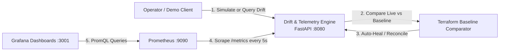
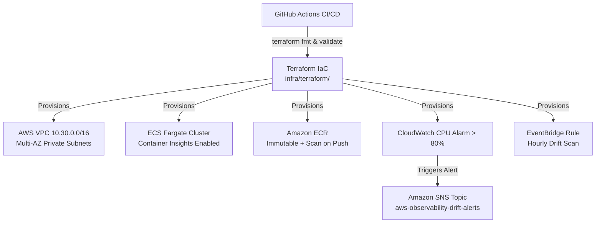

# AWS Observability, Drift Detection & Auto-Remediation Engine

> **Goal — Utilize AI Effectively for Engineering Productivity (Infrastructure Project #1):** A self-healing cloud observability and Terraform configuration drift detection platform built with **Terraform**, **Prometheus**, **Grafana**, **Python FastAPI**, and **GitHub Actions** (`AWS Account: 160071257600 | Region: ap-south-1`).

---

## 1. Overview & Problem Statement

In production AWS environments, out-of-band manual changes made directly in the AWS Console (such as opening a security group to `0.0.0.0/0`, scaling down ECS tasks, or disabling RDS encryption) cause **configuration drift** away from your Terraform Infrastructure-as-Code (IaC) baseline. Left undetected, configuration drift introduces security vulnerabilities, compliance failures, and service outages.

This platform implements an automated **Detect → Alert → Self-Heal** infrastructure control loop:

1. **Continuous Drift Detection:** Compares live environment state against the desired Terraform baseline (`VPC CIDR`, `ECS desired count`, `RDS encryption`, `Security Group CIDRs`, and mandatory FinOps tags) and classifies findings by severity (`CRITICAL` vs. `WARNING`).
2. **Real-Time Observability (`Prometheus` + `Grafana`):** Exposes custom infrastructure drift and performance gauges at `/metrics`, scraped every 5 seconds by Prometheus and visualized in Grafana.
3. **Autonomous Self-Healing Reconciliation:** Restores drifted attributes to the approved Terraform baseline via `POST /api/drift/remediate`, increments remediation counters, and resets alert gauges.
4. **Chaos & Drift Simulation:** Provides `POST /api/drift/simulate` to safely test security regressions and CPU/5xx spikes locally without risking live AWS workloads.
5. **Production AWS Infrastructure (`infra/terraform/`):** Provisions a multi-AZ VPC with private subnets, ECS Fargate cluster with Container Insights, immutable ECR repository with image scanning, SNS incident topic, CloudWatch CPU alarm (`> 80%`), and hourly EventBridge drift-scan rules in AWS Account `160071257600`.

---

## 2. System Architecture

### Local Observability & Self-Healing Control Loop (`docker-compose`)



### AWS Production Infrastructure (`ap-south-1`)



---

## 3. Repository Structure

```text
aws-observability-drift-engine/
├── .github/
│   └── workflows/
│       └── ci.yml                       # Automated pytest suite & Terraform fmt/validate on push/PR
├── infra/
│   └── terraform/
│       ├── main.tf                      # VPC, Subnets, ECS Fargate, ECR, CloudWatch, SNS, EventBridge
│       ├── outputs.tf                   # ECS Cluster Name, SNS Topic ARN & ECR Repository URL
│       └── variables.tf                 # AWS Account, Region & project variables
├── observability/
│   ├── prometheus.yml                   # Prometheus scrape configuration
│   └── grafana/
│       └── provisioning/
│           └── datasources/
│               └── datasource.yml       # Prometheus datasource provisioning
├── service/
│   ├── Dockerfile                       # Non-root Python 3.11-slim container image
│   ├── main.py                          # FastAPI drift detector and Prometheus metrics exporter
│   ├── requirements.txt                 # Python dependencies
│   └── tests/
│       └── test_main.py                 # Drift detection and remediation tests
├── docker-compose.yml                   # Drift Engine, Prometheus, and Grafana services
├── Makefile                             # Developer shortcuts
├── .gitignore                           # Generated files and local secrets
└── README.md                            # Project documentation
```

---

## 4. Prerequisites

- **Docker and Docker Compose:** Required to run the local observability stack. Check with `docker --version` and `docker compose version`.
- **Terraform CLI (>= 1.5.0):** Required only for `make tf-validate` or local AWS deployments.
- **AWS CLI (>= 2.x):** Required only when provisioning live resources in AWS Account `160071257600`.

---

## 5. Step-by-Step Local Setup & Usage Guide

### Step 1: Clone and Start the Observability Stack

```bash
git clone git@github.com:suyash460/aws-observability-drift-engine.git
cd aws-observability-drift-engine

# Build and start Drift Engine (:8080), Prometheus (:9090), and Grafana (:3001)
make up

# Verify all three containers are running
make ps
```

### Step 2: Open Service Endpoints

| Service | Local URL | Purpose |
|---|---|---|
| Drift Engine Swagger UI | [http://localhost:8080/docs](http://localhost:8080/docs) | Interactive REST API documentation |
| Prometheus Metrics Feed | [http://localhost:8080/metrics](http://localhost:8080/metrics) | Prometheus metrics scraped every 5 seconds |
| Prometheus Web UI | [http://localhost:9090](http://localhost:9090) | Query metrics and inspect scrape target health |
| Grafana UI | [http://localhost:3001](http://localhost:3001) | Prometheus datasource and dashboards |

### Step 3: End-to-End Drift Detection & Auto-Remediation

#### 1. Verify the Initial Healthy Baseline

```bash
curl -s http://localhost:8080/api/drift/status | python3 -m json.tool
```

Expected result: `"in_sync": true`, `"drift_count": 0`, and `"drifts": []`.

#### 2. Simulate Out-of-Band AWS Console Drift

Simulate an unauthorized console change that opens security group ingress to `0.0.0.0/0`, scales ECS down to one task, and disables RDS storage encryption:

```bash
curl -s -X POST http://localhost:8080/api/drift/simulate \
  -H "Content-Type: application/json" \
  -d '{
    "sg_ingress_cidrs": ["0.0.0.0/0"],
    "ecs_desired_count": 1,
    "rds_storage_encrypted": false
  }' | python3 -m json.tool
```

Expected result: Three drifted attributes (`sg_ingress_cidrs` and `rds_storage_encrypted` are `CRITICAL`; `ecs_desired_count` is `WARNING`), simulated CPU at 88.2%, and 5xx rate at 4.5%.

#### 3. Verify Alert Gauges in Prometheus & Grafana

```bash
curl -s http://localhost:8080/metrics | grep aws_infra_drift
```

Expected output:

```text
aws_infra_drift_detected 1
aws_infra_drift_items_count 3
```

In Prometheus ([http://localhost:9090](http://localhost:9090)), open **Status → Targets** to confirm the `aws-drift-exporter` is UP, then query `aws_infra_drift_detected`.

In Grafana ([http://localhost:3001](http://localhost:3001)), open **Explore**, select the Prometheus datasource, and query `aws_ecs_cluster_cpu_utilization_percent` or `aws_infra_drift_items_count`.

#### 4. Trigger Self-Healing Remediation

Reconcile live state with the Terraform baseline:

```bash
curl -s -X POST http://localhost:8080/api/drift/remediate | python3 -m json.tool
```

Expected result: `"remediated": true`, `"in_sync": true`, the repaired attributes are listed, and `aws_infra_drift_detected` returns to `0`.

### Step 4: Run Automated Tests & Terraform Validation

```bash
# Run pytest unit and integration tests inside the running container
make test

# Validate Terraform formatting and syntax offline (no AWS credentials needed)
make tf-validate
```

### Step 5: View Logs or Tear Down

```bash
# Follow container logs
make logs

# Stop and remove containers and networks
make down
```

---

## 6. REST API & Prometheus Metrics Reference

### REST API Endpoints

| Method | Path | Request body | Description |
|---|---|---|---|
| `GET` | `/health` | None | Returns service health, target AWS account, and region. |
| `GET` | `/api/drift/status` | None | Compares live state against the `DESIRED_STATE` Terraform baseline and returns drift items. |
| `POST` | `/api/drift/simulate` | `{"sg_ingress_cidrs": [...], "ecs_desired_count": int, "rds_storage_encrypted": bool}` | Mutates simulated live state to test drift detection and alert spikes. |
| `POST` | `/api/drift/remediate` | None | Restores drifted attributes to `DESIRED_STATE` and increments `aws_infra_remediations_total`. |
| `GET` | `/metrics` | None | Exposes Prometheus text metrics for scraping. |

### Exported Prometheus Metrics

| Metric name | Type | Description |
|---|---|---|
| `aws_infra_drift_detected` | Gauge | `1` when live AWS state diverges from the Terraform baseline; otherwise `0`. |
| `aws_infra_drift_items_count` | Gauge | Number of drifted infrastructure attributes. |
| `aws_infra_remediations_total` | Counter | Total automated drift remediations performed. |
| `aws_ecs_cluster_cpu_utilization_percent` | Gauge | Simulated ECS Fargate cluster CPU utilization percentage. |
| `aws_alb_http_5xx_rate_percent` | Gauge | Simulated Application Load Balancer HTTP 5xx error percentage. |

---

## 7. Desired Terraform Baseline (`DESIRED_STATE`)

The drift detection engine validates live attributes against this baseline:

```json
{
  "vpc_cidr": "10.30.0.0/16",
  "ecs_desired_count": 2,
  "rds_storage_encrypted": true,
  "sg_ingress_cidrs": ["10.30.0.0/16"],
  "mandatory_tags": {
    "Environment": "production",
    "ManagedBy": "terraform",
    "Account": "160071257600"
  }
}
```

---

## 8. Deploying Infrastructure to AWS

The Terraform configuration in `infra/terraform/` sets `allowed_account_ids = ["160071257600"]` to prevent accidental deployment to the wrong AWS account.

```bash
cd infra/terraform

# Verify active AWS credentials belong to account 160071257600
aws sts get-caller-identity

# Initialize providers, preview execution plan, and apply
terraform init
terraform plan -out=tfplan
terraform apply tfplan

# Clean up AWS resources when finished
terraform destroy
```

### Provisioned AWS Resources

- **VPC & Networking:** `aws_vpc.main` (`10.30.0.0/16`) with multi-AZ private subnets (`ap-south-1a`, `ap-south-1b`).
- **Compute & Registry:** `aws_ecs_cluster.main` (Container Insights enabled) and `aws_ecr_repository.drift_engine` (immutable tags and scan on push).
- **Monitoring, Alerting & Scheduling:** `aws_cloudwatch_metric_alarm.ecs_high_cpu` (`> 80%` threshold), `aws_sns_topic.infra_alerts`, and `aws_cloudwatch_event_rule.scheduled_drift_check` (`rate(1 hour)`).

---

## 9. CI/CD Pipeline (`.github/workflows/ci.yml`)

Every push or pull request targeting `main` automatically runs:

- **Python unit and integration tests:** Installs dependencies from `service/requirements.txt` and runs `python -m pytest -v` inside `service/`.
- **Terraform validation:** Runs `terraform init -backend=false`, `terraform fmt -check -recursive`, and `terraform validate` inside `infra/terraform/`.

---

## 10. Troubleshooting

| Issue | Cause | Resolution |
|---|---|---|
| Service `drift-engine` is not running on `make test` | Containers have not been started. | Run `make up`, wait a few seconds, then run `make test`. |
| Port 8080, 9090, or 3001 is already in use | Another container or process is bound to the port. | Stop the other process or update the host port mappings in `docker-compose.yml`. |
| Terraform `allowed_account_ids` error on `terraform plan` | The active AWS CLI profile is authenticated to a different account. | Switch credentials/profile to Account `160071257600` and verify with `aws sts get-caller-identity`. |

---

## 11. How AI Was Used for Engineering Productivity

This project directly fulfills the goal **“Utilize AI Effectively for Engineering Productivity — Deliver 2 complete infrastructure projects leveraging AI for faster development and problem-solving.”**

- **Rapid Multi-Service Infrastructure Scaffolding:** Used AI pair-programming to architect and generate the FastAPI Prometheus exporter, Prometheus scrape configuration, Grafana datasource provisioning, non-root Docker container, and AWS Terraform resources (VPC, ECS Fargate, CloudWatch, SNS, EventBridge).
- **Closed-Loop Self-Healing Architecture:** Designed the drift engine as an autonomous state reconciler (Detect → Classify Severity → Reconcile → Reset Metrics), paired with a safe chaos simulation endpoint for deterministic incident-response testing.
- **Accelerated Debugging & Automated Quality Gates:** Used AI to resolve ARM64/Linux `pydantic-core` container wheel compatibility, configure isolated pytest execution (`PYTHONPATH=.`), and enforce Terraform formatting and validation checks in GitHub Actions.
